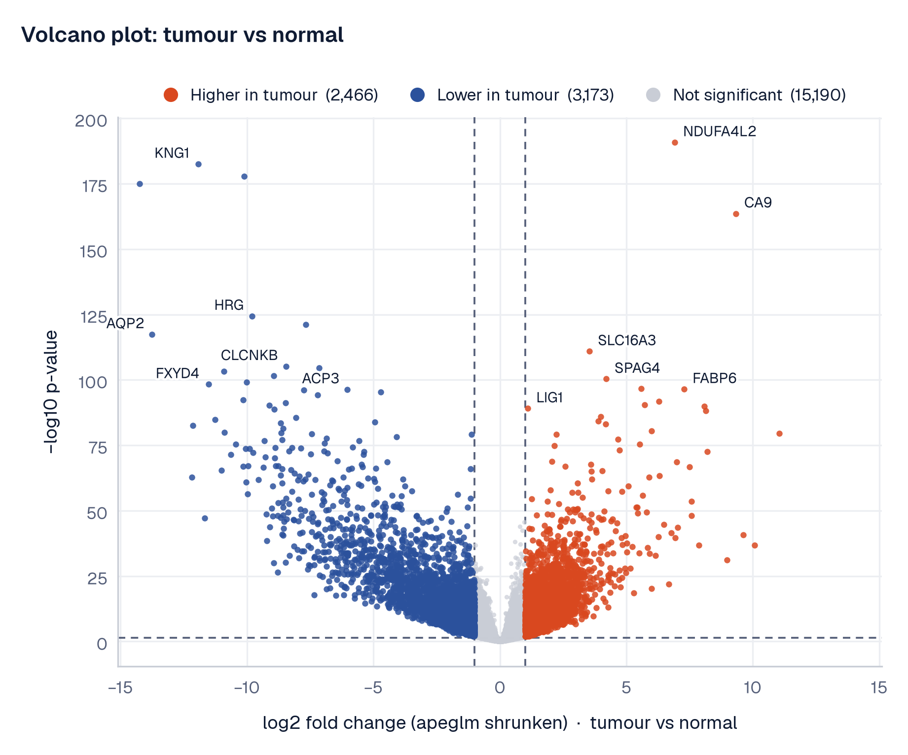
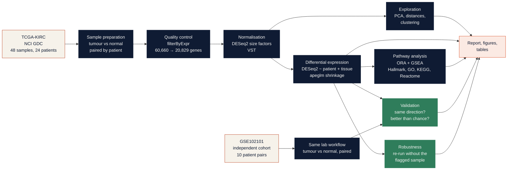
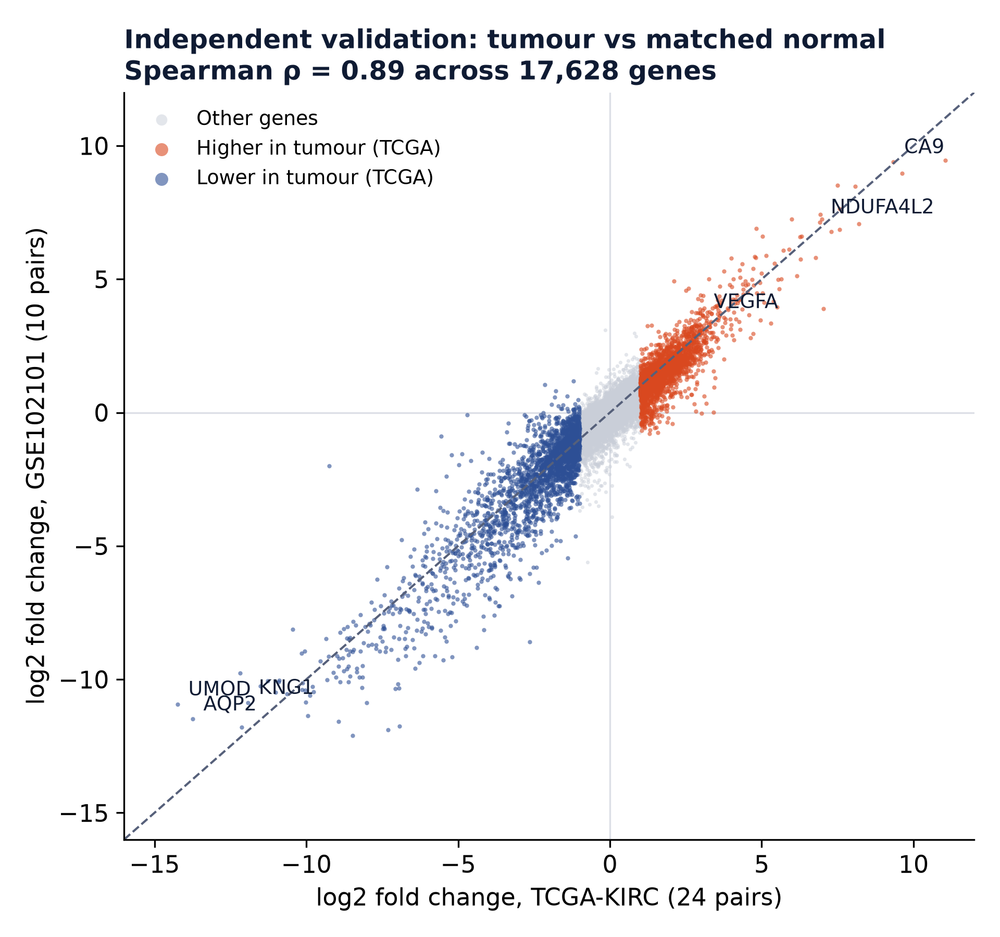

<p align="center"></p>

# Kidney cancer versus matched normal kidney: a bulk RNA-seq analysis in the LSMA Analysis Lab

**Which genes and pathways change when kidney tissue becomes clear cell renal cell carcinoma?**

This repository is a worked example from the **LSMA Analysis Lab**, the analysis platform of the [London School of Multiomics & AI](https://lsma.co.uk). The full analysis was run in the lab, without writing code: import of public data, quality control, normalisation, exploration, differential expression and pathway analysis. The report, figures and summary tables it produced are here.

| | |
|---|---|
| **Data** | TCGA-KIRC (The Cancer Genome Atlas, kidney renal clear cell carcinoma), open-access RNA-seq counts |
| **Samples** | 48: tumour and adjacent normal kidney from the same 24 patients |
| **Comparison** | tumour vs normal, paired by patient |
| **Lab module** | Bulk RNA-seq (workflow version 1.2.0) |
| **Lab run time** | **5 min 31 s** for the whole analysis (plus 50 s to import the data from the GDC) |
| **Validation** | Independent cohort GSE102101 (10 patient pairs), same lab workflow: **4 min 36 s**. Robustness re-run without one flagged sample: **5 min 1 s** |
| **Result** | **Replicated**: 98% of the strongly changed genes, and all 34 significant pathways, move the same way in the independent cohort |

---

## Biological question and aim

**Question.** When normal kidney tissue becomes clear cell renal cell carcinoma, which genes change their activity, and which biological processes do those changes point to?

**Hypothesis.** If the loss of *VHL* drives this cancer, tumours should show a constant "low oxygen" (hypoxia) programme, with glycolysis rising and mitochondrial energy production falling, even though the tissue has oxygen. Specialised kidney functions should be lost as the tubule cells turn into cancer cells.

**Aims**
1. Compare each patient's tumour with their own normal kidney (24 pairs, TCGA-KIRC) to find the genes that change, and by how much.
2. Find the pathways those genes belong to, and test whether hypoxia, metabolism and immune processes stand out.
3. Check the findings in an independent group of patients (GSE102101) and confirm they don't depend on a single unusual sample.
4. Show each step as it is run in the LSMA Analysis Lab, so a student can repeat it.

---

## Background: clear cell kidney cancer

**Kidney cancer** is among the ten most common cancers in adults. **Clear cell renal cell carcinoma (ccRCC)** is its most frequent form, about three in four cases. It starts in the cells lining the kidney's tubules, the small channels that filter blood and make urine. Under the microscope its cells look clear because they are packed with fat and glycogen.

**One gene sits at the centre of the disease.** In most clear cell tumours, both copies of the **VHL** tumour suppressor gene are lost, through mutation, silencing, or loss of chromosome 3p.
- VHL normally switches off the hypoxia-inducible factors (HIFs) when there is enough oxygen.
- Without it, the cell behaves as if it were starved of oxygen. It builds new blood vessels (VEGF), changes its metabolism towards glycolysis, and expresses hypoxia genes such as **CA9**.
- This "pseudo-hypoxia" is why drugs that block blood-vessel growth (anti-VEGF) and, more recently, HIF-2α inhibitors are used in this cancer.

**It is also an immune-rich tumour.** Clear cell kidney cancers are often heavily infiltrated by immune cells, one reason immune checkpoint therapy is part of standard treatment.

**Why compare tumour with normal tissue from the same patients?** Each person's normal kidney is the cleanest possible control. Comparing a tumour with the patient's own adjacent normal tissue removes differences between people (age, genetics, lifestyle) and leaves the changes caused by the cancer itself. That's the question this analysis asks.

---

## Key findings

1. **Tumour and normal kidney are very different.** The first principal component separates the two groups and explains 61% of the variation between samples (Figure 1).
2. **5,639 genes change at least two-fold** (adjusted p < 0.05): 2,466 are higher in tumour and 3,173 lower. Across all fold changes, 13,696 of 20,829 tested genes differ significantly.
3. **The top tumour genes are the classic marks of this cancer.**
   - Clear cell kidney cancer usually loses the *VHL* gene, which leaves the hypoxia (HIF) pathway switched on even when oxygen is normal.
   - Its targets lead the list: **NDUFA4L2** (6.9 log2 units higher), **CA9** (9.3), **ANGPTL4** (6.3), **EGLN3** (4.7) and **VEGFA** (3.1).
   - CA9 is the textbook marker of clear cell kidney cancer (Figure 3).
4. **Normal kidney function is lost in the tumour.** Genes of the healthy nephron fall sharply: **UMOD** (−14.2), **AQP2** (−13.8), **KNG1** (−11.9), **SLC12A1** (−10.9) and **CALB1** (−10.1).
5. **The pathways tell the same story** (Figure 8, gene set enrichment analysis on the MSigDB Hallmark collection). 34 of the 50 Hallmark pathways change significantly.
   - **Up in tumour:**
     - immune activity: allograft rejection (NES 3.4), interferon-gamma response (3.2), inflammatory response
     - cell division: E2F targets (3.0), G2/M checkpoint
     - **hypoxia** (2.5) and **glycolysis** (2.2)
   - **Down in tumour:** oxidative phosphorylation (−2.4) and fatty acid metabolism (−1.9).
   - Together this is the well-known metabolic switch of clear cell kidney cancer, away from the mitochondria and towards glycolysis, and its strong immune infiltration.

Each result carries the lab's evidence label. PCA and clustering are *exploratory*; the gene list is *statistically supported*; the pathway readings are *biological interpretation* and need independent confirmation.

---

## Figures

| | |
|---|---|
|  **Figure 1.** PCA of the 48 samples (500 most variable genes). Tumours (orange) and normals (blue) separate on PC1. |  **Figure 3.** Volcano plot, tumour vs normal. Each dot is a gene; coloured genes pass adjusted p < 0.05 and a two-fold change. |
|  **Figure 5.** The most significant genes across all samples. |  **Figure 8.** Hallmark pathways ranked by normalised enrichment score. |

All 10 figures are in [`figures/`](figures), as PNG (300 dpi) and vector PDF:

| File | What it shows |
|---|---|
| 01-pca | PCA of the 48 samples |
| 02-sample_correlation | Sample correlation heatmap |
| 03-volcano | Volcano plot, tumour vs normal |
| 04-ma | MA plot |
| 05-de_heatmap | Heatmap of the most significant genes |
| 06-top_genes | Expression of the top genes |
| 07-pvalue_histogram | P-value histogram |
| 08-gsea_hallmark | Hallmark pathways, gene set enrichment analysis |
| 09-ora_hallmark | Hallmark pathways, over-representation analysis |
| 10-gsea_curves | Gene set enrichment curves |

## The full report

The lab's own report covers every stage: what was done, why, the checks, the results and their limits. It's available as a [**PDF**](report/LSMA-Analysis-Lab-report-kidney-cancer-bulk-RNA-seq.pdf) or as [**HTML**](report/LSMA-Analysis-Lab-report-kidney-cancer-bulk-RNA-seq.html) (download it and open it in a browser for the interactive version).

## Summary tables ([`results/`](results))

| File | Contents |
|---|---|
| `top100_higher_in_tumour.tsv` | The 100 most significant genes higher in tumour (padj < 0.05, at least two-fold) |
| `top100_lower_in_tumour.tsv` | The 100 most significant genes lower in tumour |
| `gsea_hallmark_all.tsv` | Gene set enrichment results for all 50 Hallmark pathways |

Columns: Ensembl ID, gene symbol, mean normalised expression, log2 fold change (apeglm-shrunken), its standard error, Wald statistic, p-value and Benjamini–Hochberg adjusted p-value.

---

## Workflow



## How it was done

Every step below is a stage in the LSMA Analysis Lab, run with the settings in [`settings/analysis-settings.json`](settings/analysis-settings.json) (random seed 42).

1. **Data import.**
   - The study was found in the lab's public data search and imported from the NCI Genomic Data Commons (GDC).
   - 24 primary tumours and the 24 matched normal samples from the same patients were taken.
   - The counts are unstranded STAR gene counts from the GDC's uniform pipeline (GENCODE v36).
2. **Sample preparation.** The comparison was `tissue`: tumour against normal as the reference.
   - The lab detected that every patient has one sample in each group and proposed a **paired design** (`~ patient + tissue`).
   - All 48 samples were kept.
3. **Quality control.**
   - edgeR `filterByExpr` kept 20,829 of 60,660 genes.
   - Library sizes range from 23.6 to 80.4 million reads.
4. **Normalisation.** DESeq2 median-of-ratios size factors, with a variance-stabilising transformation for exploration. The size factors agree with TMM (r = 0.997).
5. **Exploration.** PCA, sample distances and hierarchical clustering on the 500 most variable genes.
6. **Differential expression.**
   - Method: DESeq2 Wald test, with Benjamini–Hochberg correction.
   - Effect sizes: apeglm-shrunken fold changes.
   - Thresholds: significance at padj < 0.05; |log2 fold change| > 1 for the "strong" lists.
7. **Pathway analysis.**
   - Over-representation analysis (clusterProfiler) and gene set enrichment analysis (fgsea, genes ranked by the Wald statistic).
   - Collections: MSigDB Hallmark, GO Biological Process, KEGG and Reactome.
   - Background: all tested genes.

**Software:** R 4.5.2 and Bioconductor 3.21, with DESeq2 1.48.2, apeglm 1.30.0, edgeR 4.6.3, limma 3.64.3, clusterProfiler 4.16.0, fgsea 1.34.2 and msigdbr 26.1.1.

## Validation

A result from one cohort shows the analysis is sound, not that the findings hold elsewhere. So it was checked twice, both times in the LSMA Analysis Lab with the same workflow and settings.

### 1. An independent cohort
**GSE102101** (Yao et al., *Cancer Discovery* 2017) holds clear cell kidney tumours and adjacent normal kidney from **10 different patients**. It was sequenced by a different group, in a different country and lab. It was imported from GEO and analysed exactly as above: tumour vs normal, paired by patient. Lab run time: **4 min 36 s**. The genes called in TCGA were then looked up in this second cohort:

| Gene list from TCGA | Measured in GSE102101 | Same direction | Same direction **and** significant | Better than chance? |
|---|---|---|---|---|
| Top 100 higher in tumour | 90 | **90 (100%)** | 90 (100%) | p = 8 × 10⁻²⁸ |
| Top 100 lower in tumour | 95 | **95 (100%)** | 94 (99%) | p = 2 × 10⁻²⁹ |
| All 5,639 strongly changed genes | 4,674 | **4,579 (98%)** | 4,231 (91%) | p < 10⁻³⁰⁰ |

*Genes not measured in the second cohort were filtered out there for low expression, or are named differently between the two gene annotations. "Better than chance" is a one-sided binomial test against the 50% expected if directions were random.*

- **Fold changes agree closely:** Spearman ρ = 0.89 across 17,628 genes measured in both (figure below).
- **The marker genes:** CA9 is 9.3 log2 units higher in TCGA and 9.4 in GSE102101. UMOD, KNG1, AQP2, SLC12A1 and CALB1 are all strongly lower in both.
- **The pathways:** all **34** Hallmark pathways significant in TCGA move the same way in GSE102101, and **30** are significant there too. That includes hypoxia (NES 2.5 and 2.4), glycolysis (2.2 and 2.1), oxidative phosphorylation (−2.4 and −2.4) and interferon-gamma response (3.2 and 3.1).



**Figure V1.** Each dot is a gene: its fold change in TCGA (x) against GSE102101 (y). Genes called in TCGA are coloured. The dashed line marks perfect agreement.

**Verdict: replicated.**

### 2. Robustness: without the flagged sample
The lab's quality control flagged one tumour, TCGA-B0-5706-01A, as less correlated with the others. The whole analysis was run again without it (lab run time **5 min 1 s**):
- 96 of the top 100 genes are the same.
- Fold changes correlate at ρ = 0.999.
- 95% of the strongly changed genes overlap.
- All 34 significant Hallmark pathways stay significant in the same direction.

The conclusions do not depend on that sample.

All validation files, including the lab's reports for both extra runs, are in [`validation/`](validation).

## Limitations

- **One sample was flagged by quality control.** TCGA-B0-5706-01A was kept in the main analysis. The robustness check above shows it doesn't change the conclusions.
- **Tissue type and sample type are the same thing here.** "Tumour" and "Primary Tumor" coincide by definition, so the lab's confounding check is expected and harmless.
- **Bulk tissue mixes cell types.** Part of the immune and stromal signal reflects how many immune cells are in each sample, not only changes inside cancer cells.
- **Associations, not mechanisms.** Pathway results show coordinated changes; they don't prove cause.
- **A teaching example, not clinical advice.** These results are for education and must not be used to diagnose or treat anyone.

## Repository structure

```
lsma-lab-bulk-rnaseq-kidney-cancer-tcga-kirc/
├── README.md                  this case study
├── LICENSE                    CC BY 4.0
├── assets/
│   └── lsma-lab-kidney-banner.svg        animated banner
├── report/                    the LSMA Analysis Lab's full report of the main run
│   ├── LSMA-Analysis-Lab-report-kidney-cancer-bulk-RNA-seq.pdf
│   └── LSMA-Analysis-Lab-report-kidney-cancer-bulk-RNA-seq.html
├── figures/                   10 key figures, PNG (300 dpi) and vector PDF
│   ├── 01-pca              ·  02-sample_correlation  ·  03-volcano
│   ├── 04-ma               ·  05-de_heatmap          ·  06-top_genes
│   ├── 07-pvalue_histogram ·  08-gsea_hallmark       ·  09-ora_hallmark
│   └── 10-gsea_curves
├── results/                   summary tables (tab-separated)
│   ├── top100_higher_in_tumour.tsv
│   ├── top100_lower_in_tumour.tsv
│   └── gsea_hallmark_all.tsv
├── validation/                independent cohort and robustness check
│   ├── validation-fold-change-agreement.png / .pdf
│   ├── replication_summary.tsv
│   ├── hallmark_pathways_three_analyses.tsv
│   ├── LSMA-Analysis-Lab-report-validation-GSE102101.pdf
│   └── LSMA-Analysis-Lab-report-robustness-without-flagged-sample.pdf
└── settings/
    └── analysis-settings.json           every parameter, software version and the random seed
```

## Data source and credits

- **Data:**
  - The Cancer Genome Atlas (TCGA-KIRC), open-access gene expression quantification from the [NCI Genomic Data Commons](https://portal.gdc.cancer.gov/projects/TCGA-KIRC). Use of the data follows the [GDC data use policies](https://gdc.cancer.gov/access-data/data-access-processes-and-tools).
  - Validation cohort [GSE102101](https://www.ncbi.nlm.nih.gov/geo/query/acc.cgi?acc=GSE102101), raw counts generated by NCBI GEO.
  - No raw data are copied into this repository.
- **Validation study:** Yao X, Tan J, Lim KJ, et al. VHL deficiency drives enhancer activation of oncogenes in clear cell renal cell carcinoma. *Cancer Discovery* 2017;7:1284–1305 (PMID 28893800).
- **Reference study:** Cancer Genome Atlas Research Network. Comprehensive molecular characterization of clear cell renal cell carcinoma. *Nature* 2013;499:43–49.
- **Methods:**
  - Love, Huber & Anders, *Genome Biology* 2014 (DESeq2)
  - Zhu, Ibrahim & Love, *Bioinformatics* 2019 (apeglm)
  - Chen, Lun & Smyth, *F1000Research* 2016 (edgeR filtering)
  - Korotkevich et al., *bioRxiv* 2021 (fgsea)
  - Wu et al., *The Innovation* 2021 (clusterProfiler)
  - Liberzon et al., *Cell Systems* 2015 (MSigDB Hallmark)

## Run it yourself

Diploma students of the London School of Multiomics & AI can repeat this analysis in the **LSMA Analysis Lab**:
1. **Public data** → TCGA → *TCGA-KIRC* → Gene expression.
2. 24 tumour and 24 normal samples.
3. Confirm the paired preparation.
4. Run the **Bulk RNA-seq** workflow.

Find out more about the diplomas at [lsma.co.uk](https://lsma.co.uk).

## Licence

The text, figures and tables in this repository are shared under [Creative Commons Attribution 4.0 (CC BY 4.0)](https://creativecommons.org/licenses/by/4.0/): you may reuse them with credit to the London School of Multiomics & AI. TCGA data remain under their own terms.

---

**Dr. Anas Alzaeem**, Academic Director, London School of Multiomics & AI


