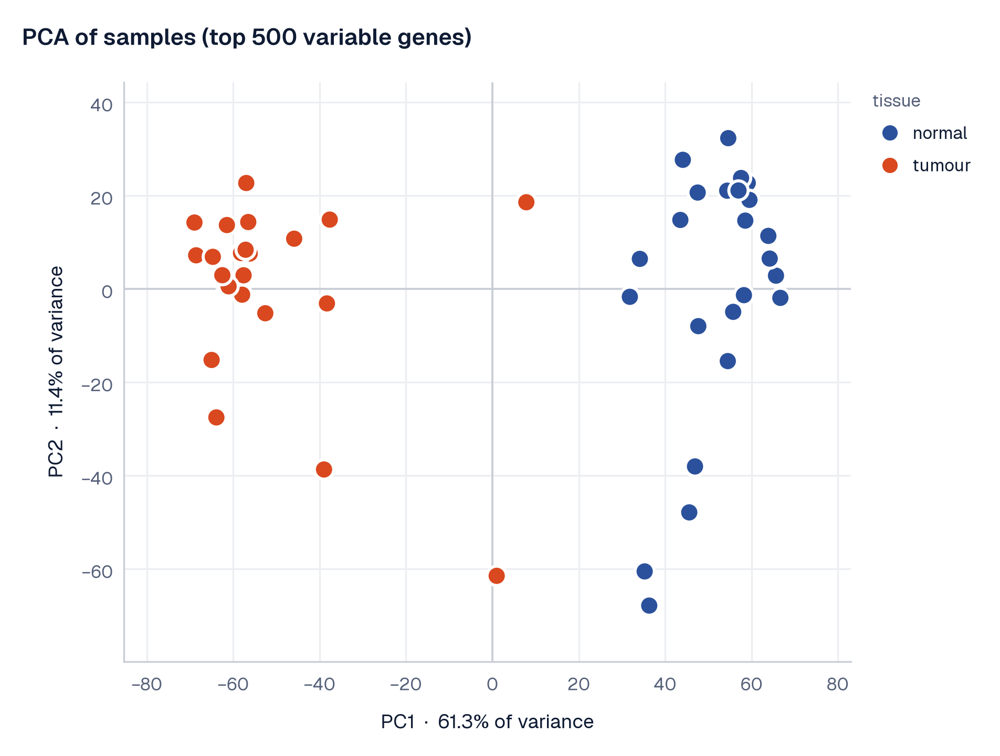
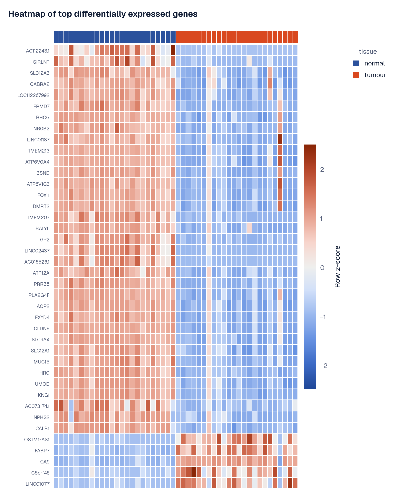
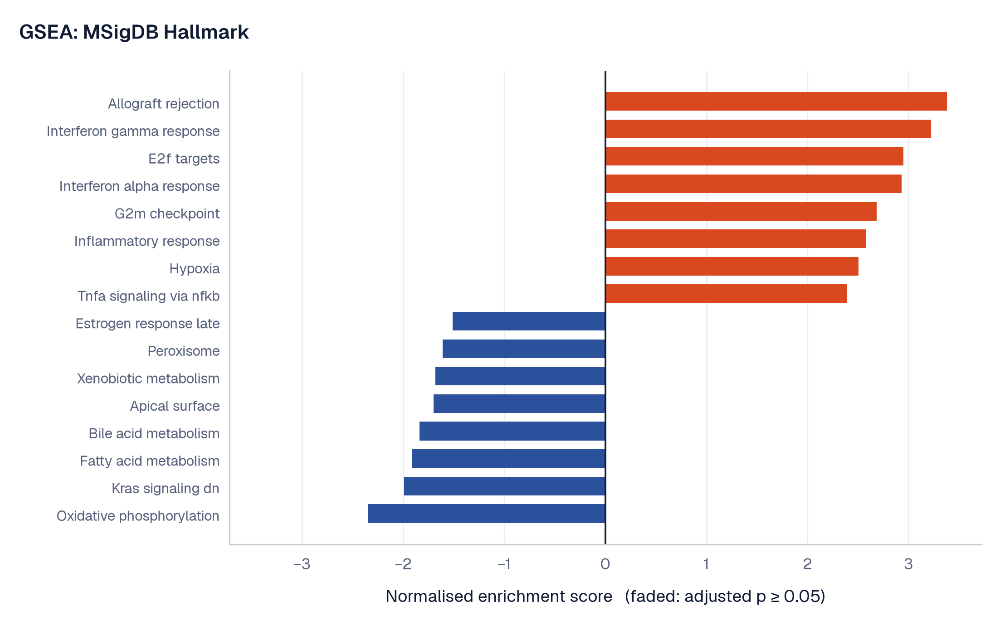

# Kidney cancer versus matched normal kidney: a bulk RNA-seq analysis in the LSMA Analysis Lab

**Which genes and pathways change when kidney tissue becomes clear cell renal cell carcinoma?**

This repository is a worked example from the **LSMA Analysis Lab**, the analysis platform of the [London School of Multiomics & AI](https://lsma.co.uk). The full analysis was run in the lab, without writing code: import of public data, quality control, normalisation, exploration, differential expression and pathway analysis. The report, figures and summary tables it produced are here.

| | |
|---|---|
| **Data** | TCGA-KIRC (The Cancer Genome Atlas, kidney renal clear cell carcinoma), open-access RNA-seq counts |
| **Samples** | 48: tumour and adjacent normal kidney from the same 24 patients |
| **Comparison** | tumour vs normal, paired by patient |
| **Lab module** | Bulk RNA-seq (workflow version 1.2.0) |
| **Lab run time** | **5 min 31 s** for the whole analysis (plus 50 s to import the data from the GDC) |

---

## Key findings

1. **Tumour and normal kidney are very different.** The first principal component separates the two groups and explains 61% of the variation between samples (Figure 1).
2. **5,639 genes change at least two-fold** (adjusted p < 0.05): 2,466 are higher in tumour and 3,173 lower. Across all fold changes, 13,696 of 20,829 tested genes differ significantly.
3. **The top tumour genes are the classic marks of this cancer.**
   - Clear cell kidney cancer usually loses the *VHL* gene, which leaves the hypoxia (HIF) pathway switched on even when oxygen is normal.
   - Its targets lead the list: **NDUFA4L2** (6.9 log2 units higher), **CA9** (9.3), **ANGPTL4** (6.3), **EGLN3** (4.7) and **VEGFA** (3.1).
   - CA9 is the textbook marker of clear cell kidney cancer (Figure 3).
4. **Normal kidney function is lost in the tumour.** Genes of the healthy nephron fall sharply: **UMOD** (−14.2), **AQP2** (−13.8), **KNG1** (−11.9), **SLC12A1** (−10.9) and **CALB1** (−10.1).
5. **The pathways tell the same story** (Figure 8, gene set enrichment analysis on the MSigDB Hallmark collection). 34 of the 50 Hallmark pathways change significantly.
   - **Up in tumour:**
     - immune activity: allograft rejection (NES 3.4), interferon-gamma response (3.2), inflammatory response
     - cell division: E2F targets (3.0), G2/M checkpoint
     - **hypoxia** (2.5) and **glycolysis** (2.2)
   - **Down in tumour:** oxidative phosphorylation (−2.4) and fatty acid metabolism (−1.9).
   - Together this is the well-known metabolic switch of clear cell kidney cancer, away from the mitochondria and towards glycolysis, and its strong immune infiltration.

Each result carries the lab's evidence label. PCA and clustering are *exploratory*; the gene list is *statistically supported*; the pathway readings are *biological interpretation* and need independent confirmation.

---

## Figures

| | |
|---|---|
|  **Figure 1.** PCA of the 48 samples (500 most variable genes). Tumours (orange) and normals (blue) separate on PC1. |  **Figure 3.** Volcano plot, tumour vs normal. Each dot is a gene; coloured genes pass adjusted p < 0.05 and a two-fold change. |
|  **Figure 5.** The most significant genes across all samples. |  **Figure 8.** Hallmark pathways ranked by normalised enrichment score. |

All 10 figures are in [`figures/`](figures), as PNG (300 dpi) and vector PDF:

| File | What it shows |
|---|---|
| 01-pca | PCA of the 48 samples |
| 02-sample_correlation | Sample correlation heatmap |
| 03-volcano | Volcano plot, tumour vs normal |
| 04-ma | MA plot |
| 05-de_heatmap | Heatmap of the most significant genes |
| 06-top_genes | Expression of the top genes |
| 07-pvalue_histogram | P-value histogram |
| 08-gsea_hallmark | Hallmark pathways, gene set enrichment analysis |
| 09-ora_hallmark | Hallmark pathways, over-representation analysis |
| 10-gsea_curves | Gene set enrichment curves |

## The full report

The lab's own report covers every stage: what was done, why, the checks, the results and their limits. It's available as a [**PDF**](report/LSMA-Analysis-Lab-report-kidney-cancer-bulk-RNA-seq.pdf) or as [**HTML**](report/LSMA-Analysis-Lab-report-kidney-cancer-bulk-RNA-seq.html) (download it and open it in a browser for the interactive version).

## Summary tables ([`results/`](results))

| File | Contents |
|---|---|
| `top100_higher_in_tumour.tsv` | The 100 most significant genes higher in tumour (padj < 0.05, at least two-fold) |
| `top100_lower_in_tumour.tsv` | The 100 most significant genes lower in tumour |
| `gsea_hallmark_all.tsv` | Gene set enrichment results for all 50 Hallmark pathways |

Columns: Ensembl ID, gene symbol, mean normalised expression, log2 fold change (apeglm-shrunken), its standard error, Wald statistic, p-value and Benjamini–Hochberg adjusted p-value.

---

## How it was done

Every step below is a stage in the LSMA Analysis Lab, run with the settings in [`settings/analysis-settings.json`](settings/analysis-settings.json) (random seed 42).

1. **Data import.**
   - The study was found in the lab's public data search and imported from the NCI Genomic Data Commons (GDC).
   - 24 primary tumours and the 24 matched normal samples from the same patients were taken.
   - The counts are unstranded STAR gene counts from the GDC's uniform pipeline (GENCODE v36).
2. **Sample preparation.** The comparison was `tissue`: tumour against normal as the reference.
   - The lab detected that every patient has one sample in each group and proposed a **paired design** (`~ patient + tissue`).
   - All 48 samples were kept.
3. **Quality control.**
   - edgeR `filterByExpr` kept 20,829 of 60,660 genes.
   - Library sizes range from 23.6 to 80.4 million reads.
4. **Normalisation.** DESeq2 median-of-ratios size factors, with a variance-stabilising transformation for exploration. The size factors agree with TMM (r = 0.997).
5. **Exploration.** PCA, sample distances and hierarchical clustering on the 500 most variable genes.
6. **Differential expression.**
   - Method: DESeq2 Wald test, with Benjamini–Hochberg correction.
   - Effect sizes: apeglm-shrunken fold changes.
   - Thresholds: significance at padj < 0.05; |log2 fold change| > 1 for the "strong" lists.
7. **Pathway analysis.**
   - Over-representation analysis (clusterProfiler) and gene set enrichment analysis (fgsea, genes ranked by the Wald statistic).
   - Collections: MSigDB Hallmark, GO Biological Process, KEGG and Reactome.
   - Background: all tested genes.

**Software:** R 4.5.2 and Bioconductor 3.21, with DESeq2 1.48.2, apeglm 1.30.0, edgeR 4.6.3, limma 3.64.3, clusterProfiler 4.16.0, fgsea 1.34.2 and msigdbr 26.1.1.

## Limitations

- **One sample was flagged by quality control.** The lab's quality control flagged TCGA-B0-5706-01A for low correlation with the others, and one tumour sits between the two groups on the PCA. All samples were kept. With 24 pairs, one sample has limited influence, but repeating the analysis without it would be a sensible check.
- **Tissue type and sample type are the same thing here.** "Tumour" and "Primary Tumor" coincide by definition, so the lab's confounding check is expected and harmless.
- **Bulk tissue mixes cell types.** Part of the immune and stromal signal reflects how many immune cells are in each sample, not only changes inside cancer cells.
- **Associations, not mechanisms.** Pathway results show coordinated changes; they don't prove cause.
- **A teaching example, not clinical advice.** These results are for education and must not be used to diagnose or treat anyone.

## Data source and credits

- **Data:** The Cancer Genome Atlas (TCGA-KIRC), open-access gene expression quantification from the [NCI Genomic Data Commons](https://portal.gdc.cancer.gov/projects/TCGA-KIRC). No raw data are copied into this repository. Use of the data follows the [GDC data use policies](https://gdc.cancer.gov/access-data/data-access-processes-and-tools).
- **Reference study:** Cancer Genome Atlas Research Network. Comprehensive molecular characterization of clear cell renal cell carcinoma. *Nature* 2013;499:43–49.
- **Methods:**
  - Love, Huber & Anders, *Genome Biology* 2014 (DESeq2)
  - Zhu, Ibrahim & Love, *Bioinformatics* 2019 (apeglm)
  - Chen, Lun & Smyth, *F1000Research* 2016 (edgeR filtering)
  - Korotkevich et al., *bioRxiv* 2021 (fgsea)
  - Wu et al., *The Innovation* 2021 (clusterProfiler)
  - Liberzon et al., *Cell Systems* 2015 (MSigDB Hallmark)

## Run it yourself

Diploma students of the London School of Multiomics & AI can repeat this analysis in the **LSMA Analysis Lab**:
1. **Public data** → TCGA → *TCGA-KIRC* → Gene expression.
2. 24 tumour and 24 normal samples.
3. Confirm the paired preparation.
4. Run the **Bulk RNA-seq** workflow.

Find out more about the diplomas at [lsma.co.uk](https://lsma.co.uk).

## Licence

The text, figures and tables in this repository are shared under [Creative Commons Attribution 4.0 (CC BY 4.0)](https://creativecommons.org/licenses/by/4.0/): you may reuse them with credit to the London School of Multiomics & AI. TCGA data remain under their own terms.

---

**Dr. Anas Alzaeem**, Academic Director, London School of Multiomics & AI

